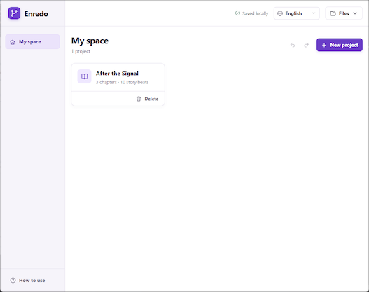

# Enredo

[English](#english) · [Português](#português)




## English

An offline visual editor for planning branching stories. Organize scenes into chapters, connect decisions and consequences, and see where different paths come back together.

Use Enredo [in your browser](#getting-started) or install the [Android app](#android-app).

### Getting started

1. Download or clone this repository and open [`index.html`](index.html) in your browser. Keep the [`web/`](web/) folder beside it. Enredo runs offline without installation.
2. In **My space**, open the sample story or click **New project**.
3. Use the **+** button next to **Chapters** to organize your story into parts. Within a chapter, click **Add story beat**.
4. Select a story beat to write notes, then click **Add path**. You can create a destination or link to an existing beat, even in another chapter.

### What you can do

- Mark each beat as a **Scene**, **Decision**, **Consequence**, **Convergence**, or **Ending**.
- Attach one image to each beat. Its thumbnail appears at the top of the diagram card and in the details panel, where you can open the original at full size.
- Use the image button next to **Aa** to set diagram thumbnails to **1x** (default), **2x**, or **3x**, or hide them. The details panel still shows the image.
- Label connections to show which choice leads to each path.
- Drag cards to rearrange the map and switch between **Timeline** and **Whole story**.
- Choose a **Narrative Model** when you create a project. Use **Structure** to explore the model and find associated beats across chapters. Set a beat’s optional **Narrative Stage** in its details panel. See the [narrative models guide](docs/narrative-models.md).
- Use **Characters** to create a central profile, add separate life phases, and connect a character to story beats. Portraits use the initials of the first and last name when no image is set.
- Record a character’s arcs and events by story path. Link an event to a map connection to use that connection’s name; later edits to the map label update the path name.
- Add one-way relationships, custom relationship types, and low, medium, or high levels for trust, loyalty, and hostility. Use the graph to open a character or relationship, then review its change history.
- Record alternative outcomes on separate paths. The editor keeps the central character profile and does not simulate which ending a playthrough reaches.
- Delete chapters or projects after confirming. Use **Undo** to recover a deletion while the tab is open.

### Language, saving, and backups

Enredo starts in English. Use the language selector at the top to choose **Português**. The browser remembers your choice the next time you open the editor.

Projects and original images are saved automatically in your browser. To back up or transfer a story with its original images and thumbnails, open it and choose **Files → Export project (.json)**. In the destination browser or computer, choose **Files → Import project (.json)**.

Projects without a saved model open in **Free Structure**. Backups include the selected model and beat associations, including associations preserved after a model change.

Character profiles, phases, participant links, arcs, paths, relationships, and portraits are also saved in the project and included in JSON backups.

If you already use `Enredo.html`, export your projects there and import the JSON files into this `index.html`. Opening a copy of the editor from a different path can use a different browser storage area.

### Android app

The [Enredo APK](https://github.com/wadantasjr/Enredo/releases/latest/download/Enredo.apk) runs offline on Android 8.0 or later with an up-to-date Android System WebView. The app saves projects on your device and starts in Portuguese if your device is set to Portuguese. To transfer a project between Android and the browser, use **Files → Export project (.json)** in one version and **Files → Import project (.json)** in the other.

- Tap **Aa** at the top to set the text size between 75% and 130%. The Android app starts at 85% and remembers your choice.
- Pinch with two fingers to zoom the diagram. Drag the background with one finger to move the map, or drag a card in **Timeline** to reposition it.
- Tap **Full screen diagram** in the diagram toolbar to expand the workspace. Use the details icon to collapse or reopen the panel. To return to the editor, tap **Exit full screen** or use Android's **Back** action.

#### Build on Windows

Use PowerShell 7, JDK 11 or 17, and the Android SDK with platform 36 and Build Tools 34.0.0. The script also looks for the SDK and JDK bundled with Unity.

```powershell
pwsh -File .\android\build.ps1
```

If needed, specify the tool locations with `-AndroidSdk` and `-JavaHome`. The build uses the [Android source files](android/app/src/main) and packages the same [`index.html`](index.html) and [`web/`](web/) directory used by the browser. The script verifies the signature and writes the result to `android/Enredo.apk`.

The APK uses a development signing key at `android/.signing/enredo-debug.jks`. Keep this key to build updates that can be installed over the original APK. Use a release key to distribute the app through an app store.

## Português

Editor visual offline para planejar histórias ramificadas. Organize cenas por capítulo, conecte decisões e consequências e veja onde os caminhos da história voltam a se encontrar.

Use o Enredo [no navegador](#como-começar) ou instale o [aplicativo Android](#aplicativo-android).

### Como começar

1. Baixe ou clone o repositório e abra o [`index.html`](index.html) no navegador. Mantenha a pasta [`web/`](web/) ao lado do arquivo. O Enredo funciona offline, sem instalação.
2. Em **Meu espaço**, abra a história de exemplo ou clique em **Novo projeto**.
3. Use o botão **+** ao lado de **Capítulos** para organizar a história em partes. Dentro de um capítulo, clique em **Adicionar situação**.
4. Selecione uma situação para escrever notas e clique em **Adicionar caminho**. Você pode criar uma situação de destino ou ligar a uma que já existe, inclusive em outro capítulo.

### O que você pode fazer

- Identificar cada situação como **Cena**, **Decisão**, **Consequência**, **Convergência** ou **Desfecho**.
- Anexar uma imagem a cada situação. A miniatura aparece no topo do cartão e no painel de detalhes, onde você pode abrir a imagem no tamanho original.
- Usar o botão de imagem ao lado de **Aa** para ajustar as miniaturas do diagrama para **1x** (padrão), **2x** ou **3x**, ou ocultá-las. A imagem continua disponível no painel de detalhes.
- Nomear as conexões para indicar qual escolha leva a cada caminho.
- Arrastar cartões para reorganizar o mapa e alternar entre **Timeline** e **História inteira**.
- Escolher um **Modelo Narrativo** ao criar um projeto. Use **Estrutura** para consultar o modelo e localizar situações de vários capítulos. No painel de detalhes, escolha a **Etapa Narrativa** de cada situação. Veja o [guia de modelos narrativos](docs/narrative-models.md).
- Use **Personagens** para criar uma ficha central, registrar fases diferentes e ligar personagens às situações. Sem retrato, o editor mostra as iniciais do primeiro e do último nome.
- Registre arcos e acontecimentos por caminho. Ao ligar um acontecimento a uma conexão do mapa, o caminho usa o nome dessa conexão. Se o rótulo mudar no mapa, o nome também muda.
- Cadastre relacionamentos direcionais e tipos personalizados. Registre confiança, lealdade e hostilidade em níveis baixos, médios ou altos. Use o grafo para abrir uma pessoa ou relação e consultar o histórico de mudanças.
- Registre destinos diferentes em caminhos separados. O editor mantém a ficha central e não simula qual desfecho uma partida alcança.
- Excluir capítulos e projetos mediante confirmação. Use **Desfazer** enquanto a aba estiver aberta para recuperar uma exclusão.

### Idioma, salvamento e backup

O Enredo abre em inglês por padrão. No seletor de idioma no topo da tela, escolha **Português**. O navegador guarda essa preferência para a próxima vez que você abrir o editor.

O Enredo salva os projetos e as imagens originais automaticamente no navegador. Para guardar uma cópia ou transferir a história com as imagens originais e miniaturas, abra o projeto e escolha **Arquivos → Exportar projeto (.json)**. No navegador ou computador de destino, use **Arquivos → Importar projeto (.json)**.

Projetos sem modelo salvo abrem em **Estrutura Livre**. O JSON inclui o modelo e as associações das situações, inclusive as que ficam guardadas após a troca de modelo.

As fichas, fases, participações, arcos, caminhos, relacionamentos e retratos também ficam salvos no projeto e são incluídos no backup JSON.

Se já estiver usando o `Enredo.html`, exporte seus projetos por lá e importe os arquivos JSON neste `index.html`. Abrir uma cópia do editor em outro caminho pode fazer o navegador usar um armazenamento diferente.

### Aplicativo Android

O [APK do Enredo](https://github.com/wadantasjr/Enredo/releases/latest/download/Enredo.apk) funciona offline em aparelhos com Android 8.0 ou superior e o Android System WebView atualizado. O editor usa armazenamento local do aplicativo e, na primeira abertura, usa português se esse for o idioma do aparelho. Para transferir um projeto entre o Android e a versão de navegador, use **Arquivos → Exportar projeto (.json)** em uma versão e **Arquivos → Importar projeto (.json)** na outra.

- Toque em **Aa** no topo para ajustar o tamanho da fonte entre 75% e 130%. O Android começa em 85% e guarda a sua escolha.
- No diagrama, faça o gesto de pinça com dois dedos para mudar o zoom. Com um dedo, arraste o fundo para mover o mapa ou arraste um cartão na **Timeline** para mudar sua posição.
- Toque em **Diagrama em tela cheia** na barra do diagrama para expandir o espaço de trabalho. Use o ícone de detalhes para recolher ou reabrir o painel. Para voltar ao editor, toque em **Sair da tela cheia** ou use **Voltar** no Android.

#### Compilar no Windows

Use PowerShell 7, JDK 11 ou 17 e o Android SDK com a plataforma 36 e Build Tools 34.0.0. O script também procura o SDK e o JDK incluídos em uma instalação do Unity.

```powershell
pwsh -File .\android\build.ps1
```

Se necessário, informe `-AndroidSdk` e `-JavaHome` com os caminhos das ferramentas. A compilação usa os [fontes Android](android/app/src/main) e empacota o mesmo [`index.html`](index.html) e a mesma pasta [`web/`](web/) usados no navegador. O script verifica a assinatura e grava o resultado em `android/Enredo.apk`.

O APK usa uma chave de desenvolvimento em `android/.signing/enredo-debug.jks`. Guarde essa chave para recompilar atualizações instaláveis sobre o APK original. Use uma chave de publicação para distribuir o app em uma loja.

## Organização do código / Code layout

- [`index.html`](index.html) contém a marcação e carrega os arquivos compartilhados pelo navegador e pelo Android.
- [`web/js/`](web/js/) separa diagrama, situações, imagens, projetos, backup, estrutura narrativa e preferências. Cada módulo expõe pela interface `Enredo` as funções que outras áreas usam. [`main.js`](web/js/main.js) inicializa o editor.
- [`web/css/`](web/css/) agrupa os estilos por área da interface.
- [`android/app/src/main/java/app/enredo/editor/`](android/app/src/main/java/app/enredo/editor/) separa a atividade principal, a janela, o WebView, a ponte JavaScript e o seletor de documentos.

Para distribuir o editor em um único arquivo, execute `pwsh -File ./scripts/build-html.ps1`. O script gera `dist/Enredo.html` a partir dos fontes compartilhados.
