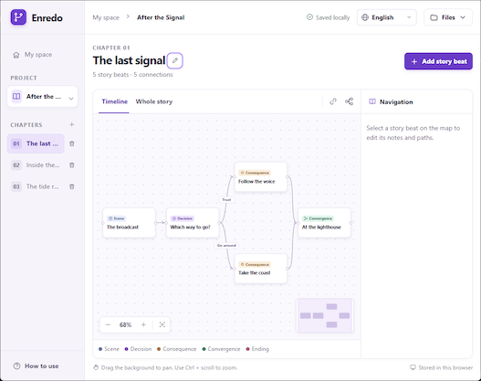

# Enredo

[English](#english) · [Português](#português)




## English

An offline visual editor for planning branching stories. Organize scenes into chapters, connect decisions and consequences, and see where different paths come back together.

Use Enredo [in your browser](#getting-started) or install the [Android app](#android-app).

### Getting started

1. Download or clone this repository and open [`index.html`](index.html) in your browser. Keep the [`web/`](web/) folder beside it. Enredo runs offline without installation.
2. In **My space**, select **After the Signal** to open the sample editor. Use **Add sample** to open a fresh copy in the current language or **New project** to start your own story.
3. Use the **+** button next to **Groups** to organize chapters into parts. You can also keep chapters ungrouped. Within a chapter, click **Add story beat**.
4. Select a story beat to write notes, then click **Add path**. You can create a destination or link to an existing beat, even in another chapter.

In the top bar, select **My space** to return to your project library or select the project name to open its overview.

### Explore the sample project

- Open **Project overview** from **My space** to see the project cover and the two illustrated groups, **The warning** and **The rescue**. Open either group to browse its chapter covers.
- In **Timeline**, select **The night shift** to see its notes, original image, focal character, narrative stage, connection and linked task. In **Map**, follow the cards from the harbor watch room along both coastal routes to the lighthouse, then back to the docks for the two endings. New copies from **Add sample** include the illustrated map.
- In **Inside the lighthouse**, open **Water at the stairs** or **The keeper’s log** to see more original images.
- Open **Structure** to find the beats associated with all 12 stages. In **Characters**, explore Mara’s two phases and compare what changes in her arc and relationships on each ending path.
- In **Project Management**, open **Kanban** to see all four task statuses. Filter by sprint or backlog, then use **Schedule** and **Gantt** to see how the work overlaps.

### What you can do

- Mark each beat as a **Scene**, **Decision**, **Consequence**, **Convergence**, or **Ending**.
- Attach one image to each beat. Its thumbnail appears at the top of the diagram card and in the details panel, where you can open the original at full size.
- Open **Display settings** to set text size and diagram thumbnails. Choose **1x** (default), **2x**, **3x**, or **Hide thumbnails**. The details panel still shows the image.
- In the same dialog, set the arrow color and line thickness separately for **Timeline**, **Whole story**, and **Map**. **Use theme color** restores the automatic color, and **Default** restores the original thickness. These preferences are saved on the device. In full screen, find **Display settings** beside the exit button.
- Label connections to show which choice leads to each path.
- Drag story beat cards in **Timeline**, **Whole story**, or **Map**. Each view saves its own positions. When opening an older project or backup with a background image, **Map** keeps the image and its existing layout. **Whole story** starts with a diagram based on the Timeline card positions. Older projects without a background keep their layout in **Whole story**.
- Use the left and right panel icons in the diagram toolbar to show or hide project navigation and the details panel independently. Both controls are also available in full screen.
- Drag the right edge of project navigation to adjust its width whenever it appears on the left, including in full screen. You can also focus the divider and use the left and right arrow keys. The minimum width is 232 pixels, and the browser remembers your setting.
- In **Whole story** or **Map**, drag a chapter or group to move it with its contents. Click its title or summary card to collapse or expand it. **Grouping** sets the current view to groups, chapters, or individual story beats. Chapters without a group appear as chapter cards when grouping by group. Connections between visible cards remain on the diagram.
- **Save grouping in the project** is on by default. Saved groupings travel with the project backup. Turn it off to try a different grouping for the current session, or turn it back on to save the current grouping.
- **Whole story** always displays the diagram without a background image. Use **Background image** in the **Map** toolbar to choose, replace, or remove an image. Once an image is set, use **Show diagram** to switch between the image alone and the diagram over it. The project backup includes both layouts and the original background image when configured.
- Create free-form chapter groups such as acts or parts. Use **Edit group** on the group overview. Expand groups in the navigation, move chapters between groups with **Move chapter to group** or drag and drop, and reorder them with the chapter menu.
- Add optional covers to projects, groups, and chapters in **Project details**, **Edit group**, and **Edit chapter**. Choose a JPG, PNG, or WebP image, adjust its 16:9 crop, and replace or remove it at any time. Chapter covers appear in navigation and chapter lists. Items without covers use a default image.
- In **Project overview**, choose **Edit story summary** to write the plot or synopsis. Format the text with bold, italics, underlining, or lists. Select text and use **Link to story** to link it to a group, chapter, or story beat. With no text selected, the link inserts the destination’s name. The summary is also editable in **Project details**.
- Open **Media gallery** from the project or group overview, the chapter heading in **Timeline** or **Edit chapter**, or a beat’s details. Use **Add files** to select multiple images and documents up to 20 MB each. Open images at full size from their thumbnails. Use the download icon next to the trash icon to download any attachment. Character profiles and task edit dialogs have an **Image gallery** with the same download controls.
- Choose a **Narrative Model** when you create a project. Use **Structure** to explore the model and find associated beats across chapters. Set a beat’s optional **Narrative Stage** in its details panel. See the [narrative models guide](docs/narrative-models.md).
- Use **Characters** to create one central profile with separate life phases. Add an optional portrait to each phase; phases without one use the central portrait. Use **Merge another profile** to combine duplicate entries and transfer arcs, map links, relationships, and portraits. Resolve relationships between the two profiles and duplicate links to the same story beat before merging.
- Record a character’s arcs and events by story path. Link an event to a map connection to use that connection’s name; later edits to the map label update the path name.
- Add one-way relationships, custom relationship types, and low, medium, or high levels for trust, loyalty, and hostility. Use the graph to open a character or relationship, then review its change history.
- Record alternative outcomes on separate paths. The editor keeps the central character profile and does not simulate which ending a playthrough reaches.
- Delete chapters or projects after confirming. Use **Undo** to recover a deletion while the tab is open.

### Project Management

- Open **Project Management → Tasks** to create tasks with a status, priority, optional dates, and an optional story beat. In the details of a story beat, use **New task** to create a task already linked to that beat. Deleting the beat keeps its tasks in the project and clears their beat link.
- Use **Sprints** to set a goal and dates and track how many tasks are done. Assign tasks to a sprint in the task form. Tasks without a sprint appear in the **Backlog**, including tasks from a deleted sprint.
- In **Kanban**, drag cards between **To do**, **In progress**, **In review**, and **Done**, or use the status selector on each card. Filter by sprint or backlog in the task list, board, and planning views.
- Use **Schedule** for an agenda of sprint dates, task starts, and due dates. Use **Gantt** to see how tasks and sprints overlap. Tasks without dates appear below both views.

### Language, saving, and backups

Enredo starts in English. Use the language selector at the top to choose **Português**. The browser remembers your choice the next time you open the editor.

Projects and their attachments are saved automatically in your browser. To back up or transfer a story with its covers, original images, documents, and attachment notes, open it and choose **Files → Export project (.json)**. In the destination browser or computer, choose **Files → Import project (.json)**.

To save a readable copy of the project, choose **Files → Export project (.pdf)** and select **Save as PDF** in the print dialog. The A4 report includes a cover, a linked table of contents, the formatted story summary, chapters and story paths, character profiles, images, document names, attachment notes, tasks, and sprints. The project overview includes the **Whole story** diagram and adds **Map** when the project has a background image. The exported map follows the **Show diagram** setting. Each chapter includes its own **Timeline**. The Characters section includes the relationship graph. Links in the summary point to the corresponding entries in the report. JSON backups also include the summary and its links. PDF export works offline in the browser and in the Android app.

Projects without a saved model open in **Free Structure**. Backups include the selected model and beat associations, including associations preserved after a model change.

Character profiles, phases, participant links, arcs, paths, relationships, and portraits are also saved in the project and included in JSON backups.

JSON backups also include tasks, sprints, and their links to story beats. Older backups open with empty task and sprint lists.

If you already use `Enredo.html`, export your projects there and import the JSON files into this `index.html`. Opening a copy of the editor from a different path can use a different browser storage area.

### Android app

The [Enredo APK](https://github.com/wadantasjr/Enredo/releases/latest/download/Enredo.apk) runs offline on Android 8.0 or later with an up-to-date Android System WebView. The app saves projects on your device and starts in Portuguese if your device is set to Portuguese. To transfer a project between Android and the browser, use **Files → Export project (.json)** in one version and **Files → Import project (.json)** in the other.

Use **Project details**, **Edit group**, or **Edit chapter** to choose a JPG, PNG, or WebP cover. Android opens its image picker for the selection.
In **Media gallery**, use **Add files** to select several files in the Android picker. Tap the download icon beside any attachment to choose where to save a copy.

- Tap **Display settings** at the top to set the text size between 75% and 130%. The Android app starts at 85% and remembers your choice.
- Pinch with two fingers to zoom the diagram. Drag the background with one finger to move the map, or drag a card in **Timeline**, **Whole story**, or **Map** to reposition it.
- Tap **Full screen diagram** in the diagram toolbar to expand the workspace. To return to the editor, tap **Exit full screen** or use Android's **Back** action.

#### Build on Windows

Use PowerShell 7, JDK 11 or 17, and the Android SDK with platform 36 and Build Tools 34.0.0. The script also looks for the SDK and JDK bundled with Unity.

```powershell
pwsh -File .\android\build.ps1
```

If needed, specify the tool locations with `-AndroidSdk` and `-JavaHome`. The build uses the [Android source files](android/app/src/main) and packages the same [`index.html`](index.html) and [`web/`](web/) directory used by the browser. The script verifies the signature and writes the result to `android/Enredo.apk`.

The APK uses a development signing key at `android/.signing/enredo-debug.jks`. Keep this key to build updates that can be installed over the original APK. Use a release key to distribute the app through an app store.

## Português

Editor visual offline para planejar histórias ramificadas. Organize cenas por capítulo, conecte decisões e consequências e veja onde os caminhos da história voltam a se encontrar.

Use o Enredo [no navegador](#como-começar) ou instale o [aplicativo Android](#aplicativo-android).

### Como começar

1. Baixe ou clone o repositório e abra o [`index.html`](index.html) no navegador. Mantenha a pasta [`web/`](web/) ao lado do arquivo. O Enredo funciona offline, sem instalação.
2. Em **Meu espaço**, selecione **Depois do sinal** para abrir o editor do exemplo. Use **Adicionar exemplo** para abrir uma nova cópia no idioma selecionado ou **Novo projeto** para começar sua própria história.
3. Use o botão **+** ao lado de **Grupos** para organizar os capítulos em partes. Você também pode manter capítulos sem grupo. Dentro de um capítulo, clique em **Adicionar situação**.
4. Selecione uma situação para escrever notas e clique em **Adicionar caminho**. Você pode criar uma situação de destino ou ligar a uma que já existe, inclusive em outro capítulo.

Na barra superior, selecione **Meu espaço** para voltar à lista de projetos ou selecione o nome do projeto para abrir sua página de apresentação.

### Explore o projeto de exemplo

- Abra **Apresentação do projeto** em **Meu espaço** para ver a capa do projeto e os dois grupos ilustrados, **O aviso** e **O resgate**. Abra um dos grupos para ver as capas dos capítulos.
- Na **Timeline**, selecione **O turno da noite** para ver as notas, a imagem original, a personagem focal, a etapa narrativa, a conexão e a tarefa vinculada. No **Mapa**, siga os cartões da sala de vigia pelas duas rotas costeiras até o farol e volte às docas para ver os dois desfechos. Novas cópias criadas em **Adicionar exemplo** incluem o mapa ilustrado.
- Em **Dentro do farol**, abra **Água na escada** ou **O caderno do faroleiro** para ver mais imagens originais.
- Abra **Estrutura** para localizar as situações associadas às 12 etapas. Em **Personagens**, explore as duas fases de Mara e compare como seu arco e seus relacionamentos mudam em cada desfecho.
- Em **Gestão de projeto**, abra o **Kanban** para ver os quatro status das tarefas. Filtre por sprint ou backlog e use **Cronograma** e **Gantt** para ver quais trabalhos se sobrepõem.

### O que você pode fazer

- Identificar cada situação como **Cena**, **Decisão**, **Consequência**, **Convergência** ou **Desfecho**.
- Anexar uma imagem a cada situação. A miniatura aparece no topo do cartão e no painel de detalhes, onde você pode abrir a imagem no tamanho original.
- Abra **Configurações de aparência** para ajustar o tamanho da fonte e das miniaturas do diagrama. Escolha **1x** (padrão), **2x**, **3x** ou **Ocultar miniaturas**. A imagem continua disponível no painel de detalhes.
- Na mesma janela, defina a cor e a espessura das setas separadamente para **Timeline**, **História inteira** e **Mapa**. **Usar a cor do tema** restaura a cor automática e **Padrão** restaura a espessura original. Essas preferências ficam salvas no dispositivo. Em tela cheia, o botão **Configurações de aparência** fica ao lado do botão de sair.
- Nomear as conexões para indicar qual escolha leva a cada caminho.
- Arraste os cartões das situações na **Timeline**, em **História inteira** ou no **Mapa**. Cada visualização salva suas próprias posições. Ao abrir um projeto ou backup antigo com imagem de fundo, o **Mapa** mantém a imagem e a disposição existente. A **História inteira** começa com um diagrama baseado nas posições dos cartões da Timeline. Projetos antigos sem imagem de fundo mantêm sua disposição em **História inteira**.
- Use os ícones de painel esquerdo e direito na barra do diagrama para mostrar ou ocultar a navegação do projeto e o painel de detalhes de forma independente. Os dois controles também estão disponíveis em tela cheia.
- Arraste a borda direita da navegação do projeto para ajustar a largura quando ela estiver à esquerda, inclusive em tela cheia. Você também pode focar o divisor e usar as setas para a esquerda e para a direita. A largura mínima é de 232 pixels, e o navegador lembra o ajuste.
- Em **História inteira** ou no **Mapa**, arraste um capítulo ou grupo para movê-lo com seu conteúdo. Clique no título ou no cartão de resumo para recolher ou expandir. Use **Agrupamento** para mostrar a visualização atual por grupo, por capítulo ou por situação. Capítulos sem grupo aparecem como cartões de capítulo ao agrupar por grupo. As conexões entre cartões visíveis continuam no diagrama.
- **Salvar agrupamento no projeto** vem ativado. O agrupamento salvo acompanha o backup. Desmarque para experimentar outro agrupamento durante a sessão ou marque novamente para salvar o agrupamento atual.
- **História inteira** sempre exibe o diagrama sem imagem de fundo. Use **Imagem de fundo** na barra de ferramentas do **Mapa** para escolher, trocar ou remover uma imagem. Depois de definir uma imagem, use **Mostrar diagrama** para alternar entre a imagem sozinha e com o diagrama sobreposto. O backup do projeto inclui as duas disposições e a imagem de fundo original quando configurada.
- Criar grupos de capítulos com nomes livres, como atos ou partes. Use **Editar grupo** na tela do grupo. Expanda os grupos na navegação, mova capítulos entre grupos com **Mover capítulo para grupo** ou arrastar e soltar, e reordene pelo menu do capítulo.
- Adicionar capas opcionais ao projeto, aos grupos e aos capítulos em **Detalhes do projeto**, **Editar grupo** e **Editar capítulo**. Escolha uma imagem JPG, PNG ou WebP, ajuste o recorte 16:9 e substitua ou remova a capa quando quiser. As capas dos capítulos aparecem na navegação e nas listas. Itens sem capa usam uma imagem padrão.
- Na **Apresentação do projeto**, escolha **Editar resumo da história** para escrever o enredo ou a sinopse. Formate o texto com negrito, itálico, sublinhado ou listas. Selecione um trecho e use **Vincular à história** para ligá-lo a um grupo, capítulo ou situação. Com o cursor no texto e sem seleção, o link insere o nome do destino. Você também pode editar o resumo em **Detalhes do projeto**.
- Abrir a **Galeria de mídia** na visão geral do projeto ou grupo, no cabeçalho do capítulo na **Timeline** ou em **Editar capítulo**, ou nos detalhes de uma situação. Use **Adicionar arquivos** para selecionar várias imagens e documentos de até 20 MB cada. Abra imagens em tamanho original pela miniatura. Use o ícone de download ao lado da lixeira para baixar qualquer anexo. As fichas de personagens e a edição de tarefas têm uma **Galeria de imagens** com a mesma opção de download.
- Escolher um **Modelo Narrativo** ao criar um projeto. Use **Estrutura** para consultar o modelo e localizar situações de vários capítulos. No painel de detalhes, escolha a **Etapa Narrativa** de cada situação. Veja o [guia de modelos narrativos](docs/narrative-models.md).
- Use **Personagens** para criar uma ficha central com fases diferentes. Adicione um retrato opcional a cada fase; as fases sem imagem usam o retrato central. Use **Unir outra ficha** para combinar cadastros duplicados e transferir arcos, vínculos com o mapa, relacionamentos e retratos. Resolva relacionamentos entre as duas fichas e vínculos duplicados com a mesma situação antes de uni-las.
- Registre arcos e acontecimentos por caminho. Ao ligar um acontecimento a uma conexão do mapa, o caminho usa o nome dessa conexão. Se o rótulo mudar no mapa, o nome também muda.
- Cadastre relacionamentos direcionais e tipos personalizados. Registre confiança, lealdade e hostilidade em níveis baixos, médios ou altos. Use o grafo para abrir uma pessoa ou relação e consultar o histórico de mudanças.
- Registre destinos diferentes em caminhos separados. O editor mantém a ficha central e não simula qual desfecho uma partida alcança.
- Excluir capítulos e projetos mediante confirmação. Use **Desfazer** enquanto a aba estiver aberta para recuperar uma exclusão.

### Gestão de projeto

- Abra **Gestão de projeto → Tarefas** para criar tarefas com status, prioridade, datas opcionais e vínculo opcional com uma situação. Nos detalhes da situação, use **Nova tarefa** para criá-la já vinculada. Excluir a situação remove o vínculo e mantém as tarefas no projeto.
- Em **Sprints**, defina o objetivo e as datas e acompanhe quantas tarefas foram concluídas. Atribua tarefas a uma sprint pelo formulário da tarefa. Tarefas sem sprint ficam no **Backlog**, inclusive as tarefas de uma sprint excluída.
- No **Kanban**, arraste cartões entre **A fazer**, **Em andamento**, **Em revisão** e **Concluída**, ou use o seletor de status de cada cartão. Filtre por sprint ou backlog na lista de tarefas, no quadro e nas visualizações de planejamento.
- Use o **Cronograma** para consultar as datas das sprints, o início e o prazo das tarefas. Use o **Gantt** para visualizar a sobreposição de tarefas e sprints. Tarefas sem data aparecem abaixo das duas visualizações.

### Idioma, salvamento e backup

O Enredo abre em inglês por padrão. No seletor de idioma no topo da tela, escolha **Português**. O navegador guarda essa preferência para a próxima vez que você abrir o editor.

O Enredo salva projetos e seus anexos automaticamente no navegador. Para guardar uma cópia ou transferir a história com capas, imagens originais, documentos e observações dos anexos, abra o projeto e escolha **Arquivos → Exportar projeto (.json)**. No navegador ou computador de destino, use **Arquivos → Importar projeto (.json)**.

Para salvar uma versão do projeto para leitura, escolha **Arquivos → Exportar projeto (.pdf)** e selecione **Salvar como PDF** na janela de impressão. O relatório em A4 inclui capa, índice com links, o resumo formatado da história, capítulos e caminhos da história, fichas de personagens, imagens, nomes dos documentos, observações dos anexos, tarefas e sprints. A apresentação do projeto inclui o diagrama de **História inteira** e também o **Mapa** quando há uma imagem de fundo. O Mapa exportado segue a opção **Mostrar diagrama**. Cada capítulo inclui sua própria **Timeline**. A seção Personagens inclui o grafo de relações. Os links do resumo apontam para as entradas correspondentes no relatório. O backup JSON também inclui o resumo e seus links. A exportação em PDF funciona offline no navegador e no aplicativo Android.

Projetos sem modelo salvo abrem em **Estrutura Livre**. O JSON inclui o modelo e as associações das situações, inclusive as que ficam guardadas após a troca de modelo.

As fichas, fases, participações, arcos, caminhos, relacionamentos e retratos também ficam salvos no projeto e são incluídos no backup JSON.

Os backups JSON também incluem tarefas, sprints e seus vínculos com as situações. Backups antigos abrem com as listas de tarefas e sprints vazias.

Se já estiver usando o `Enredo.html`, exporte seus projetos por lá e importe os arquivos JSON neste `index.html`. Abrir uma cópia do editor em outro caminho pode fazer o navegador usar um armazenamento diferente.

### Aplicativo Android

O [APK do Enredo](https://github.com/wadantasjr/Enredo/releases/latest/download/Enredo.apk) funciona offline em aparelhos com Android 8.0 ou superior e o Android System WebView atualizado. O editor usa armazenamento local do aplicativo e, na primeira abertura, usa português se esse for o idioma do aparelho. Para transferir um projeto entre o Android e a versão de navegador, use **Arquivos → Exportar projeto (.json)** em uma versão e **Arquivos → Importar projeto (.json)** na outra.

Use **Detalhes do projeto**, **Editar grupo** ou **Editar capítulo** para escolher uma capa JPG, PNG ou WebP. O Android abre o seletor de imagens.
Na **Galeria de mídia**, use **Adicionar arquivos** para selecionar vários arquivos no seletor do Android. Toque no ícone de download de um anexo para escolher onde salvar uma cópia.

- Toque em **Configurações de aparência** no topo para ajustar o tamanho da fonte entre 75% e 130%. O Android começa em 85% e guarda a sua escolha.
- No diagrama, faça o gesto de pinça com dois dedos para mudar o zoom. Com um dedo, arraste o fundo para mover o mapa ou arraste um cartão na **Timeline**, em **História inteira** ou no **Mapa** para mudar sua posição.
- Toque em **Diagrama em tela cheia** na barra do diagrama para expandir o espaço de trabalho. Para voltar ao editor, toque em **Sair da tela cheia** ou use **Voltar** no Android.

#### Compilar no Windows

Use PowerShell 7, JDK 11 ou 17 e o Android SDK com a plataforma 36 e Build Tools 34.0.0. O script também procura o SDK e o JDK incluídos em uma instalação do Unity.

```powershell
pwsh -File .\android\build.ps1
```

Se necessário, informe `-AndroidSdk` e `-JavaHome` com os caminhos das ferramentas. A compilação usa os [fontes Android](android/app/src/main) e empacota o mesmo [`index.html`](index.html) e a mesma pasta [`web/`](web/) usados no navegador. O script verifica a assinatura e grava o resultado em `android/Enredo.apk`.

O APK usa uma chave de desenvolvimento em `android/.signing/enredo-debug.jks`. Guarde essa chave para recompilar atualizações instaláveis sobre o APK original. Use uma chave de publicação para distribuir o app em uma loja.

## Organização do código / Code layout

- [`index.html`](index.html) contém a marcação e carrega os arquivos compartilhados pelo navegador e pelo Android.
- [`web/js/`](web/js/) separa diagrama, situações, imagens, projetos, gestão de projeto, backup, estrutura narrativa e preferências. Cada módulo expõe pela interface `Enredo` as funções que outras áreas usam. [`main.js`](web/js/main.js) inicializa o editor.
- [`web/css/`](web/css/) agrupa os estilos por área da interface.
- [`android/app/src/main/java/app/enredo/editor/`](android/app/src/main/java/app/enredo/editor/) separa a atividade principal, a janela, o WebView, a ponte JavaScript e o seletor de documentos.

Para distribuir o editor em um único arquivo, execute `pwsh -File ./scripts/build-html.ps1`. O script gera `dist/Enredo.html` a partir dos fontes compartilhados.
